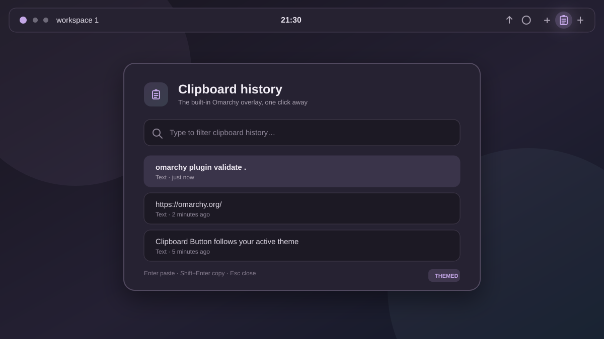

# Clipboard Button



A small, native bar button for Omarchy Quattro's built-in clipboard history.
It opens the clipboard you already use—there is no second clipboard daemon,
database, or competing overlay.

## Features

- One-click access to Omarchy's stock clipboard history.
- Theme-aware symbolic icon that follows the active bar foreground color.
- HiDPI-aware rendering and horizontal or vertical bar compatibility.
- Accessible button label and the stock `Super+Ctrl+V` shortcut in its tooltip.
- No external dependencies, network access, elevated privileges, or stored data.

## Requirements

- Omarchy 4 (Quattro) with `omarchy-shell`.
- The built-in `omarchy.clipboard` plugin enabled (the Omarchy default).

## Install

```sh
omarchy plugin add https://github.com/majesticio/omarchy-clipboard-button.git --enable
```

The widget lands in the right section by default. Move it anywhere with the
normal bar command:

```sh
omarchy bar move io.github.majesticio.clipboard-button --section right
```

## Usage

- Left-click the clipboard icon to open or close clipboard history.
- Continue using `Super+Ctrl+V` whenever the keyboard is faster.

## Update

```sh
omarchy plugin update io.github.majesticio.clipboard-button
```

## Remove

```sh
omarchy plugin remove io.github.majesticio.clipboard-button
```

Removal deletes only this button. It does not disable Omarchy's clipboard
manager or remove clipboard history.

## Privacy and security

Clipboard Button never reads or stores clipboard contents. Its only action is
asking the running Omarchy shell to toggle the built-in `omarchy.clipboard`
overlay. It ships no executable helper, installer, service, or remote code.

Like every Omarchy shell plugin, its QML executes with your user permissions.
Review the three runtime files before enabling it: `manifest.json`,
`BarWidget.qml`, and `icon.svg`.

## Development

Validate the repository against the installed Omarchy manifest contract:

```sh
omarchy plugin validate .
```

For runtime changes, copy the repository to
`~/.config/omarchy/plugins/io.github.majesticio.clipboard-button/`, enable it,
and inspect shell errors with:

```sh
qs log -p "$OMARCHY_PATH/shell" --tail 100
```

## License

MIT. The clipboard icon is original project artwork and is covered by the same
license.
